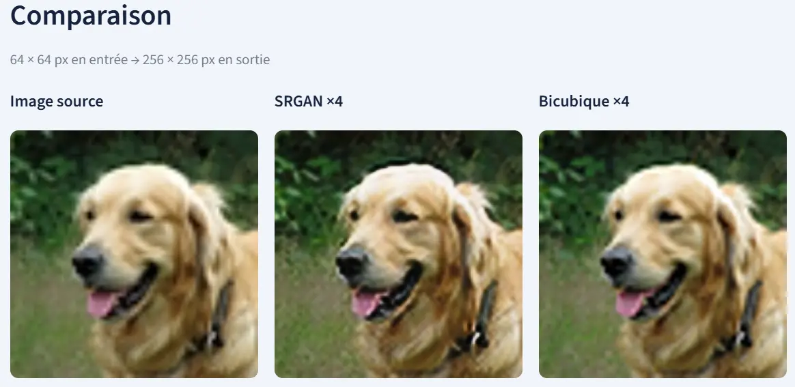
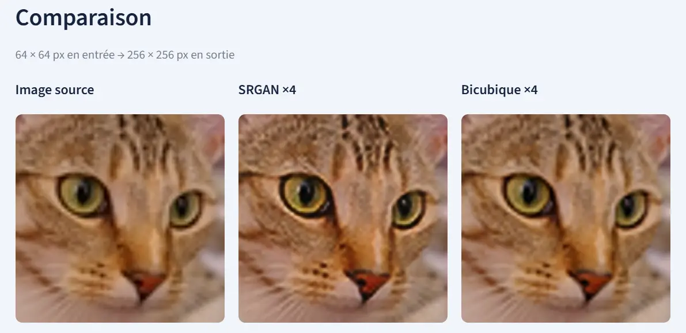
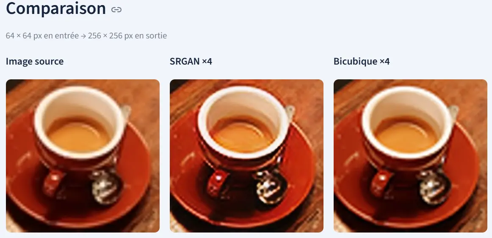
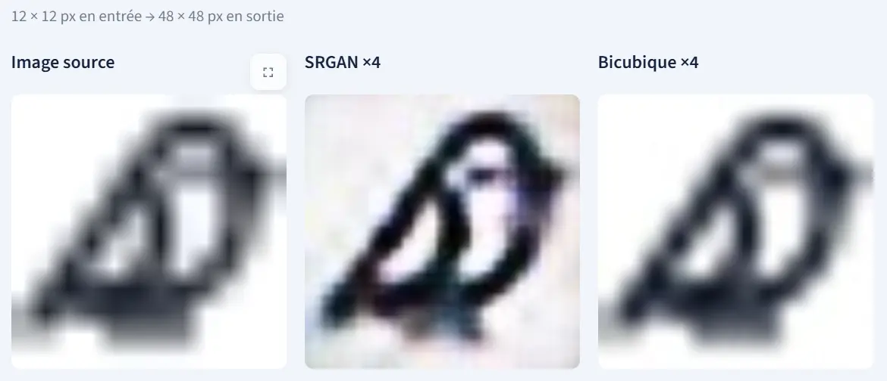
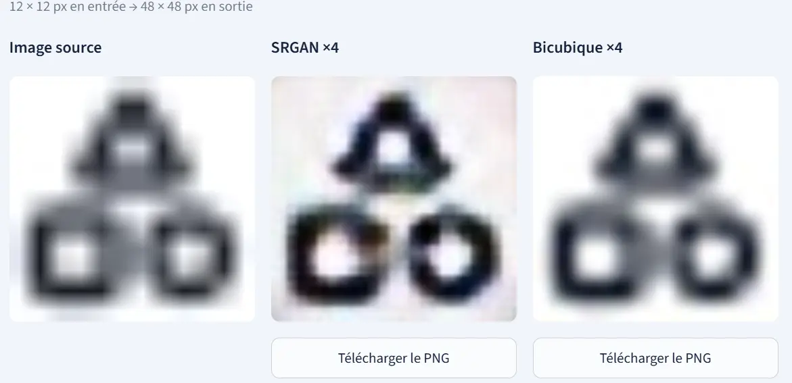
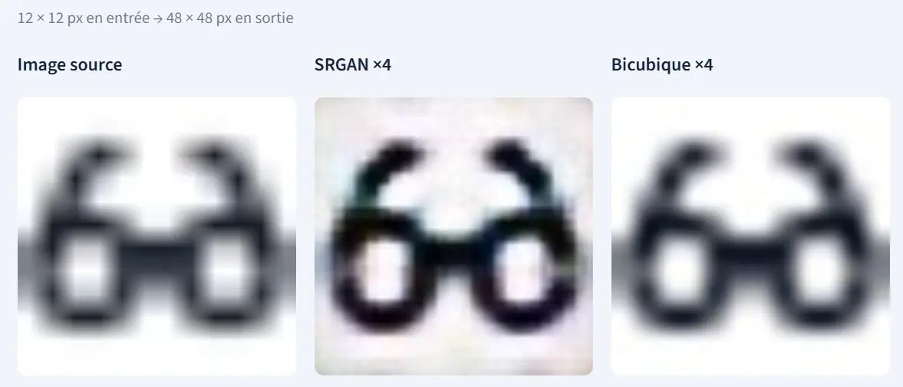

# SRGAN Image Super-Resolution ×4

A PyTorch implementation of **4× single-image super-resolution** with a Streamlit app for comparing bicubic interpolation, a generator pretrained with mean squared error (MSE), and adversarially fine-tuned SRGAN. The training notebooks run in Google Colab.

**Try the app:** import a PNG, JPEG, or WebP, select the methods to compare, then download each result as a PNG. A 64 × 64 input produces a 256 × 256 output.



<details>
<summary>More Streamlit examples</summary>

**Photos, 64 × 64 → 256 × 256**





**Icons, 12 × 12 → 48 × 48**







</details>

## Run the app locally

Install Python 3.11 and open PowerShell. Clone the repository and run these commands from the project folder.

```powershell
git clone https://github.com/ennaguiyoussef/SRGAN-Image-Super-Resolution.git
cd SRGAN-Image-Super-Resolution
py -3.11 -m venv .venv
.\.venv\Scripts\python.exe -m pip install -r requirements-app.txt
.\.venv\Scripts\python.exe -m streamlit run app.py
```

On Linux or macOS, use `python3 -m venv .venv` and `.venv/bin/python` for the last two commands. Open the local URL printed by Streamlit.

Bicubic is available immediately. Download the two weight exports from the project folder on Drive. Import them under **Poids des modèles**, or copy them into the following paths relative to the project folder.

| Method | Weight file |
| --- | --- |
| Pretrained generator, best epoch 38 | `checkpoints/pretrain_full_continue_v1/best_generator.pt` |
| Second SRGAN, best saved weights | `checkpoints/adversarial_full_v2/best_gan_generator.pt` |

When the pretrained weights are installed locally, the app selects that generator by default. Choose the methods under **Rendus à générer**, click **Générer les rendus ×4**, then use **Télécharger le PNG** below a result. The app converts inputs to RGB, accepts images up to one megapixel, and uses CUDA when available or CPU otherwise.

## Results on 50 full test images

The experiments use **800 DIV2K training images** and a fixed project split of **50 validation and 50 test images** from the official validation archive. Both evaluations use the same test images and protocol. Full HR images are trimmed to multiples of four, reduced with Pillow bicubic, and reconstructed from the same LR input by each method. The reported scores average per-image RGB PSNR and SSIM with four HR border pixels removed on each side.

| Evaluated model | Mean PSNR ↑ | Mean SSIM ↑ |
| --- | ---: | ---: |
| Bicubic ×4 | 26.491 dB | 0.76055 |
| Original pretrained generator, epoch 18 | 26.072 dB | 0.74970 |
| First GAN, epoch 3 | 25.920 dB | 0.73128 |
| Continued pretrained generator, epoch 38 | **26.553 dB** | **0.76641** |
| Second GAN, epoch 3 | 26.254 dB | 0.74091 |

The continued generator gained **0.062 dB PSNR** and **0.00586 SSIM** over bicubic on this split. The second GAN improved on the first GAN, while the continued MSE generator achieved the highest scores. The Streamlit examples illustrate how the GAN can sharpen some edges and introduce texture or color artifacts. The benchmark rows identify the evaluated checkpoints separately from these screenshots.

A later GAN continuation finished eight epochs and selected epoch 7 by validation MSE. Its validation PSNR was 25.12 dB. The test table records the three-epoch GAN exports evaluated in the notebooks below.

[First executed evaluation](https://github.com/ennaguiyoussef/SRGAN-Image-Super-Resolution/blob/149dd93bc586862d2d2c43ec83e4544c738e5e29/notebooks/05_final_evaluation.ipynb) · [Updated executed evaluation](https://github.com/ennaguiyoussef/SRGAN-Image-Super-Resolution/blob/949d071e914a1930cf474cee9bb0648ad9ca2b45/notebooks/05_final_evaluation_updated.ipynb)

## Training and evaluation notebooks

Open the notebooks in Colab with a GPU runtime. They use the project folder on Drive for the data cache, split manifest, checkpoints, and reports. The initial training patches are 24 × 24 LR and 96 × 96 HR. The generator uses 16 residual blocks and two PixelShuffle ×2 stages.

| Step | Notebook | What it does |
| --- | --- | --- |
| 1 | [Setup](notebooks/01_setup_colab.ipynb) | Check the runtime and Drive access. |
| 2 | [Data preparation](notebooks/02_data_preparation.ipynb) | Download DIV2K, define the split, and inspect LR/HR crops. |
| 3 | [Model architecture](notebooks/03_model_architecture.ipynb) | Trace generator shapes and inspect discriminator outputs. |
| 4A | [Pretraining pilot](notebooks/04a_generator_pretraining.ipynb) | Train on 100 images and resume using the saved Adam state. |
| 4A | [Full-dataset pretraining](notebooks/04a_full_dataset_pretraining.ipynb) | Transfer the pilot weights and train on all 800 images. |
| 4A | [Continue pretraining](notebooks/04a_continue_pretraining.ipynb) | Resume from epoch 20 through epoch 40 and compare validation scores. |
| 4B | [First GAN](notebooks/04b_adversarial_training.ipynb) · [Second GAN](notebooks/04b_adversarial_from_continued.ipynb) | Combine pixel, VGG19 feature, and adversarial losses with separate Adam optimizers. |
| 5 | [Initial test](notebooks/05_final_evaluation.ipynb) · [Updated test](notebooks/05_final_evaluation_updated.ipynb) | Score full test images and export the per-image CSV, summary, JSON report, and visual comparisons. |

Training saves `last.pt` for resuming model and optimizer state, and a separate weights export for inference. The final evaluation uses overlapping tiles to fit large images in memory. The updated test outputs are saved under `results/final_test_evaluation_v2/` on Drive.

## Repository map

| Path | Purpose |
| --- | --- |
| [app.py](app.py) | Streamlit image import, comparison, and download |
| [src/models](src/models) | Generator and discriminator |
| [src/pretrain.py](src/pretrain.py) · [src/adversarial.py](src/adversarial.py) | Training and checkpoint logic |
| [src/evaluation.py](src/evaluation.py) | Tiled inference and image metrics |
| [configs](configs) · [notebooks](notebooks) | Experiment settings and Colab workflows |
| [tests](tests) | CPU checks for data, models, metrics, and resume behavior |

Run the checks from the project folder after installing the dependencies.

```bash
python -m unittest discover -s tests -v
```

## References and credits

- Christian Ledig et al., [Photo-Realistic Single Image Super-Resolution Using a Generative Adversarial Network](https://openaccess.thecvf.com/content_cvpr_2017/html/Ledig_Photo-Realistic_Single_Image_CVPR_2017_paper.html), CVPR 2017.
- Eirikur Agustsson and Radu Timofte, [DIV2K dataset and NTIRE challenge](https://data.vision.ee.ethz.ch/cvl/DIV2K/). DIV2K is provided for academic research and has its own terms.
- Demo images use the [Chelsea and coffee samples from scikit-image](https://scikit-image.org/docs/0.24.x/api/skimage.data.html), [Karen Arnold’s dog photo](https://commons.wikimedia.org/wiki/File:Golden-retriever-dog.jpg), and [Lucide icons](https://lucide.dev/license).

See [LICENSE](LICENSE) for the repository code license.
